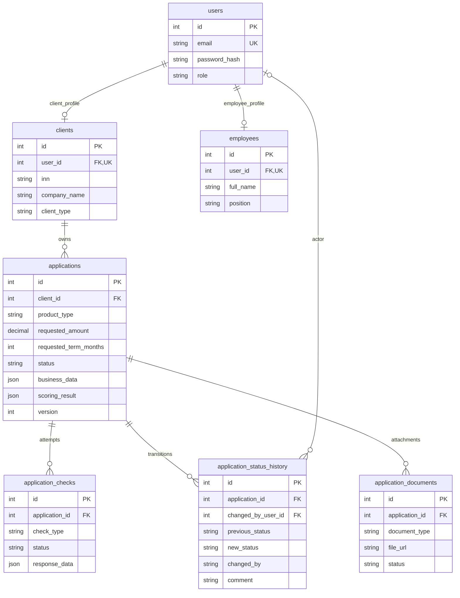

# Модель данных

Источник истины — [SQLAlchemy-модели](app/models/) и четыре
[миграции Alembic](migrations/versions/). Рабочая БД — PostgreSQL 16.
SQLite используется в изолированных API-тестах.

Схема выше сокращает поля ради читаемости. Во всех семи таблицах есть
`created_at` (timestamp с часовым поясом). Все PK — Integer. Уникальный
`user_id` в каждом профиле обеспечивает связь один-к-одному внутри таблицы;
согласованность роли и вида профиля контролирует приложение, а не ER-диаграмма.

## Учётные записи

- `users`: `email` String(320), unique; `password_hash` String(255);
  `role` String(32), значения приложения client/employee. Пароль и его хеш
  не возвращаются API. Роль повторно сверяется с пользователем БД.
- `clients`: `user_id` → users, unique; `inn` String(12), индекс;
  `company_name` String(255); `client_type` String(32).
- `employees`: `user_id` → users, unique; `full_name` String(255);
  `position` String(255).

Публичной регистрации нет. Идемпотентный seed создаёт пять клиентов и двух
сотрудников только при включённом SEED_TEST_USERS; существующие пароли сохраняет.

## Заявки и финансовые данные

`applications.client_id` ссылается на clients и определяет владельца. Остальные
поля помимо показанных в ER:

| Поле | Хранение и смысл |
|---|---|
| product_type | String(32), MVP поддерживает term_loan |
| requested_amount | Numeric(18,2), nullable для черновика |
| requested_term_months | Integer, nullable для черновика; политика 6/12/24 |
| purpose | String(500), nullable |
| status | String(32), индекс; состояния проверяются приложением |
| business_data | JSON, финансовые сведения, введённые клиентом |
| score / risk_grade | Integer / String(8), nullable, итоговая оценка |
| decision_reason_code | String(128), nullable, причина решения |
| scoring_result | JSON, nullable, сохранённые входы, факторы, PD и предложение |
| approved_amount / approved_rate | Numeric(18,2) / Numeric(8,4), nullable |
| missing_fields / info_comment | JSON-список полей, по умолчанию []; Text nullable |
| signed_at / issued_at | Timestamp с часовым поясом, nullable; имитация согласия/выдачи |
| version | Integer, обязательная версия для optimistic locking SQLAlchemy |
| updated_at | Timestamp с часовым поясом, меняется при обновлении |

`business_data.financials` содержит `annual_revenue` и `annual_expenses`.
API принимает деньги строками рублей. Расчёт использует Decimal; сохранённый
JSON содержит сериализованные денежные значения. Ставка — проценты годовых,
PD — доля. Поле API `offer` извлекается из `scoring_result.offer` только для
APPROVED/ISSUED, отдельной колонки offer нет. `next_actions` вычисляется по роли
и состоянию, в БД не хранится. Продукт задан политикой кода, таблицы products нет.

`scoring_result.inputs` сохраняет использованные финансовые сведения и ответы
источников. При ручном одобрении сохраняется также `automated_assessment` —
исходное автоматическое заключение. Финансовая карточка сотрудника использует
этот снимок, чтобы объяснение соответствовало решению.

## Проверки, история и документы

- `application_checks`: `check_type` String(32), FNS/BKI; `status` String(32),
  SUCCESS/TIMEOUT/ERROR; `response_data` JSON nullable. Каждый повтор добавляет
  новую попытку. SUCCESS означает ответ интеграции; полнота/типы дополнительно
  проверяются кредитным сервисом. Предыдущий успешный ответ не заменяет
  последнюю неудачную попытку.
- `application_status_history`: `previous_status` nullable, `new_status`,
  `changed_by` (String(32)), `changed_by_user_id` nullable FK → users,
  `comment` Text nullable. SYSTEM не имеет пользователя-автора. Действия
  сотрудников сохраняют идентификатор автора и комментарий.
- `application_documents`: `document_type` String(100), `file_url` String(1000),
  `status` String(32), обычно PENDING. `file_url` — защищённый URL скачивания,
  а не общедоступный адрес. Байты находятся в UPLOAD_DIR/постоянном томе,
  не в PostgreSQL. Доступ проверяется по владельцу заявки или роли сотрудника.

## Миграции и согласованность

1. 0001_initial_schema — семь основных таблиц.
2. 0002_application_drafts — nullable-поля черновика.
3. 0003_application_review_metadata — версия, дозаполнение, даты и автор истории.
4. 0004_application_scoring_result — сохранённый результат расчёта.

`alembic upgrade head` выполняется перед стартом API. Попытки проверок,
решение и история сохраняются одной транзакцией. Конкурирующее изменение
версии откатывается и возвращает 409. Проверки миграций и конкурентных
операций находятся в tests/test_postgres.py и используют временные схемы.

После `docker compose down` тома сохраняются. `down -v` удаляет БД и файлы.
Для резервирования прототипа нужны оба тома, а не только дамп PostgreSQL.
