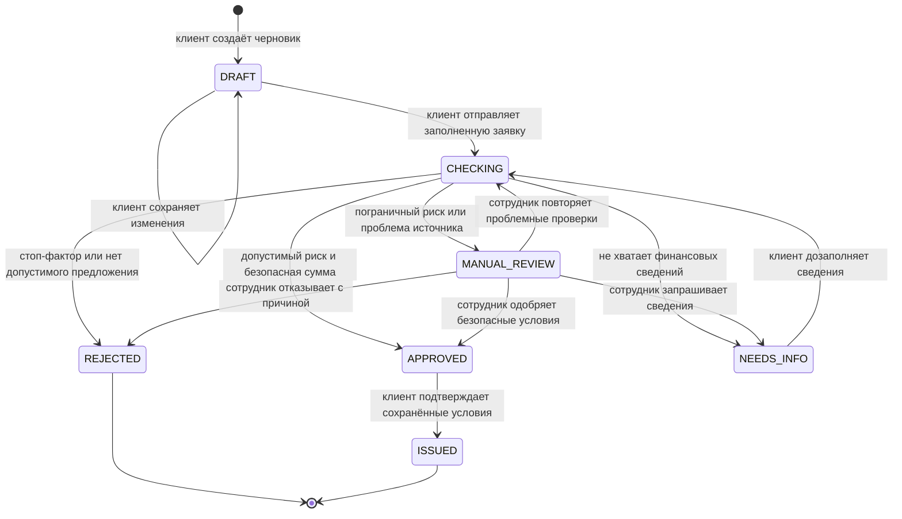

# Состояния заявки

`COUNTER_OFFER` — вид сохранённого предложения, а не отдельный статус.
Полное одобрение (`ORIGINAL`) и уменьшенная сумма (`COUNTER_OFFER`) имеют
статус APPROVED; в обоих случаях клиент должен согласиться.

CHECKING обозначает стадию в истории одной синхронной транзакции. Операции
submit/fill/retry возвращают уже итоговый статус. Ошибка выполнения приводит
к откату всей операции. Системные переходы имеют `changed_by=SYSTEM`,
`changed_by_user_id=null`; действия клиента и сотрудника сохраняют их user ID.

| Состояние | Действия клиента | Действия сотрудника |
|---|---|---|
| DRAFT | EDIT, SUBMIT | Нет решения |
| NEEDS_INFO | FILL | Нет решения |
| MANUAL_REVIEW, источники непригодны | Нет | RETRY_CHECKS |
| MANUAL_REVIEW, обязательные источники пригодны | Нет | APPROVE, REJECT, REQUEST_INFO |
| APPROVED | SIGN | Нет решения |
| REJECTED, ISSUED | Чтение результата | Чтение результата |

Таблица описывает изменения состояния. Загрузка документов — отдельная
операция и не меняет статус; для REJECTED она запрещена. Право чтения всегда
проверяется. Очередь сотрудника не включает черновики.

Все изменения существующей заявки передают положительный целочисленный
`version`. Версия при создании возвращается сервером. При 409 нужно перечитать
заявку, условия и `next_actions`; повторять старое действие вслепую нельзя.

Сотрудник не обходит стоп-факторы и DSCR ≥ 1,35 и не назначает произвольную
ставку. SIGN проверяет сохранённое предложение и его соответствие одобрению,
не запускает скоринг заново. [Подробная политика](../CREDIT_POLICY.md).
