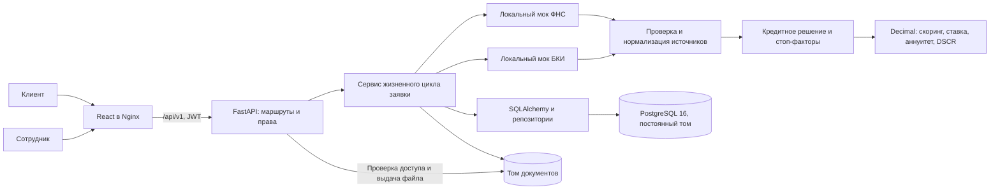

# Архитектура прототипа

Один сквозной продукт: оборотный кредит для действующего клиента. Два кабинета
используют один API и одну БД. Основной запуск описан в [README](../README.md).

## Границы ответственности

| Компонент | Реализация |
|---|---|
| HTTP, авторизация, роли | `app/api`, `app/core/security.py` |
| Изменения заявки, версия и транзакция | `app/services/application_service.py` |
| Полнота и качество исходных данных | `app/services/source_data.py` |
| Решение, стоп-факторы, запрос информации | `app/services/credit_evaluation.py` |
| Чистые расчёты без HTTP/БД | `app/services/credit_math.py` |
| Политика единственного продукта | `app/core/credit_policy.py`, [CREDIT_POLICY.md](../CREDIT_POLICY.md) |
| Данные и миграции | `app/models`, `app/repositories`, `migrations` |

Фронтенд не назначает ставку и не рассчитывает доступную сумму. Он отображает
сохранённое предложение и разрешённые сервером `next_actions`. Финансовый блок
сотрудника показывает исходные показатели последнего расчёта.

## Транзакция рассмотрения

1. Сервер проверяет владельца/роль, статус и переданную версию заявки.
2. Синхронно вызывает локальные моки ФНС и БКИ, проверяет типы и полноту.
3. Рассчитывает результат или выбирает запрос данных/ручное рассмотрение/отказ.
4. В одной транзакции сохраняет попытки проверок, расчёт, условия, состояние
   и историю переходов через CHECKING. SQLAlchemy увеличивает версию.
5. Возвращает итог. При конфликте версии — 409, без частичной истории.

Фонового worker нет. CHECKING записывается в историю, но не публикуется как
отдельно закоммиченное промежуточное состояние. Таймаут источника не равен
кредитному отказу: сотруднику доступен повтор проверок. Ручное одобрение
использует тот же расчёт и не обходит обязательные источники и DSCR.

## Что смоделировано

ФНС/БКИ и финансовые профили синтетические, внешних сетевых запросов к ним нет.
Согласие клиента имитирует подписание и выдачу, сохраняет даты и условия;
электронная подпись и перевод денег не выполняются. PD демонстрационная,
без обучения и калибровки. Синтетическая новостная лента подбирается по типу
бизнеса и последней заявке текущего клиента; внешнего новостного сервиса нет.

В Compose миграции и идемпотентное создание семи тестовых аккаунтов выполняются
до старта API. Nginx проксирует запросы после готовности API, API ожидает БД.
Записи и файлы переживают `docker compose down` без `-v`.

Связанные материалы: [состояния](APPLICATION_STATES.md), [данные](../DB.md),
[API](../Api.md), [коллекция и сценарии](TEST_SCENARIOS.md).
